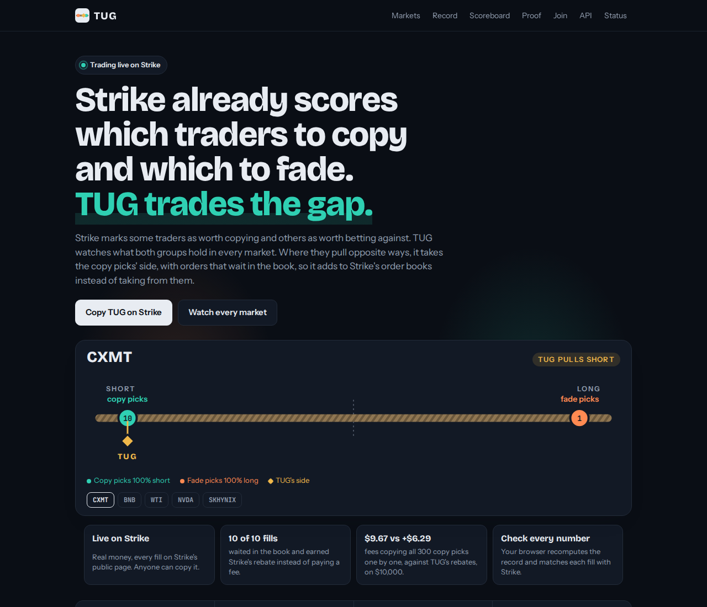
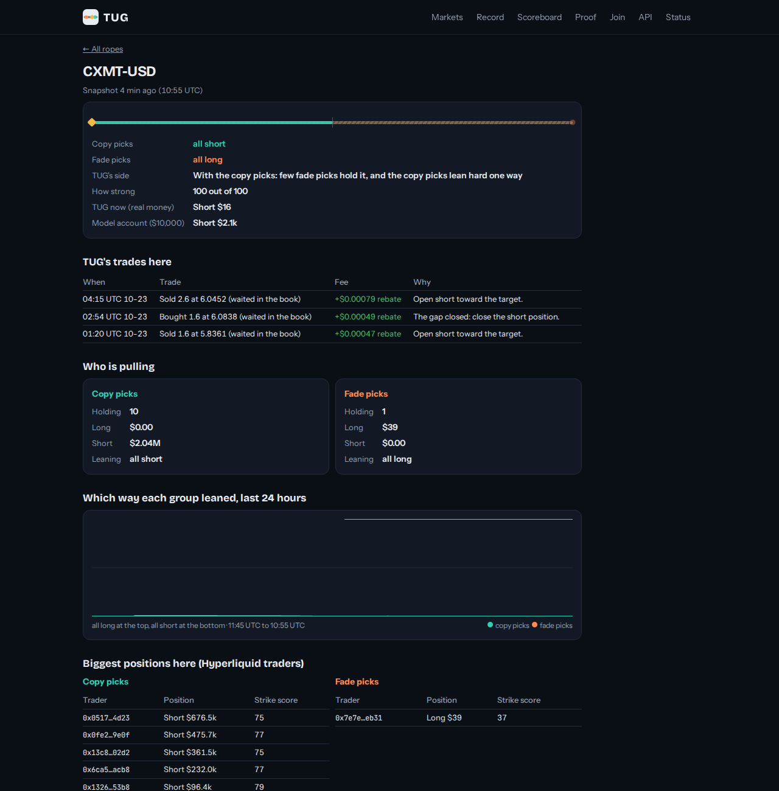
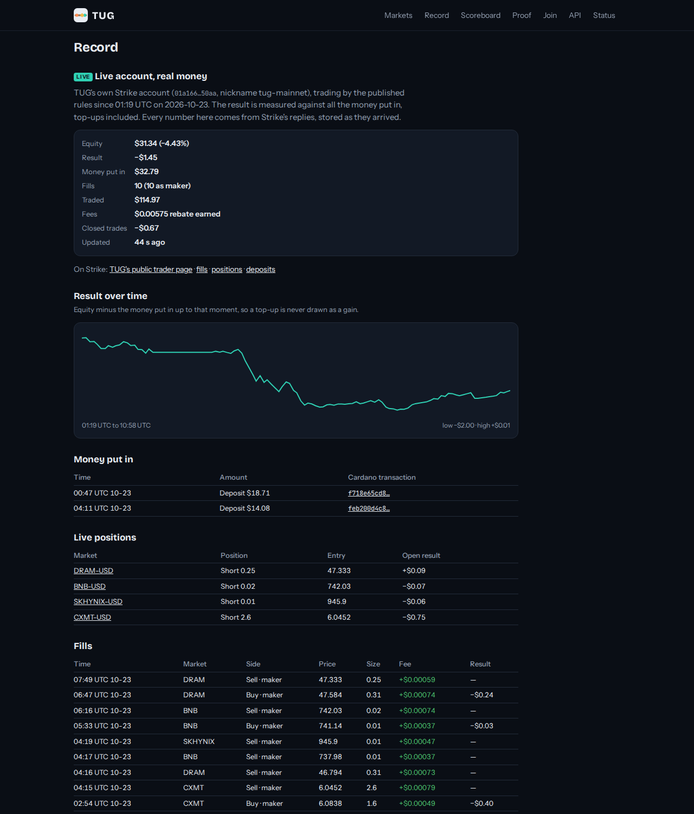
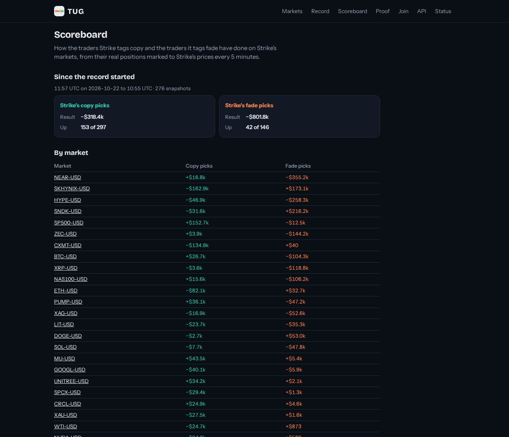
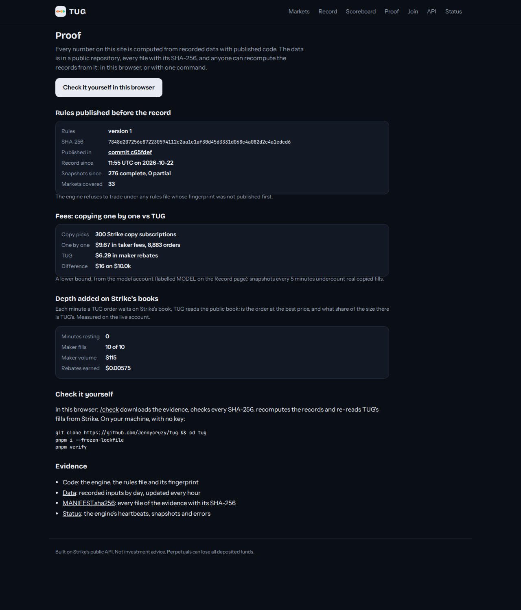
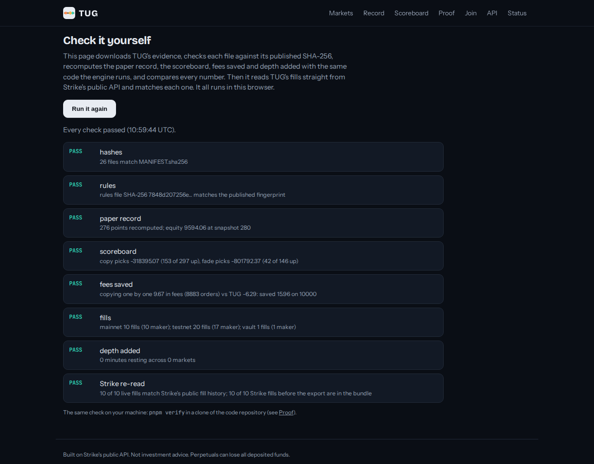
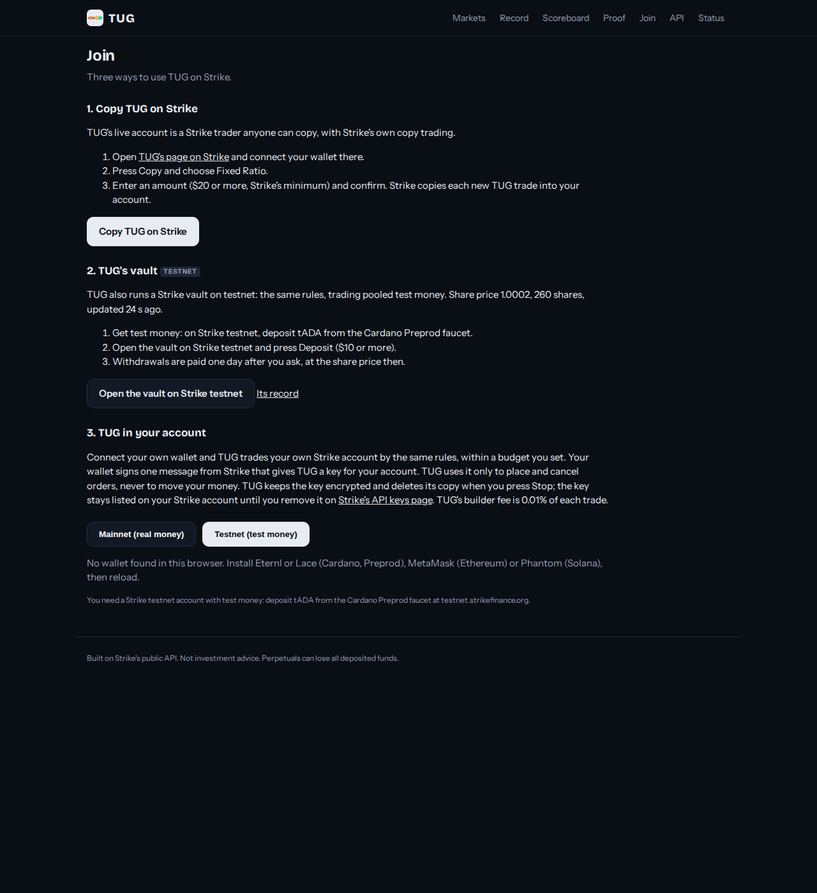

# Judging TUG in three minutes

No wallet, no money, no sign-up. Everything below is the live site: https://tug.38-49-216-59.sslip.io

## 1. Every market as a rope

The home page shows each Strike market as a rope: Strike's copy picks pull one way, its fade picks the other, and
the diamond is TUG's side. The strip under the headline is what already runs, each with a link to check it.

## 2. One market

Tap a rope. You see which way each group leans and how hard, why TUG takes a side there, TUG's position with real
money, and **TUG's trades in that market, each with the reason it was placed** and the rebate Strike paid.

## 3. The live record, on Strike

**Record**: TUG's real Strike account. Equity, the result against all money put in (from Strike's own deposit
records), every fill with its fee, and links to the same account on Strike's public pages. Below it, TUG's Strike
vault on testnet, and the $10,000 model account labelled MODEL.

On Strike itself: [TUG's public trader page](https://app.strikefinance.org/public-portfolio/@tug-mainnet).

## 4. How Strike's picks have done

**Scoreboard**: how the copy picks and the fade picks did since the record began, market by market, valued at
Strike's prices.

## 5. Proof

**Proof**: the rules fingerprint published before the record started, the fees saved against copying one by one,
the depth TUG adds to Strike's books, and how to check it all.

## 6. Check it yourself

Press **Run the check** on [/check](https://tug.38-49-216-59.sslip.io/check). Your browser downloads the evidence,
checks every file's SHA-256, recomputes the records with the engine's own code, and matches every live fill against
Strike's public history, both ways. Or on your machine: `git clone https://github.com/Jennycruzy/tug && cd tug &&
pnpm i --frozen-lockfile && pnpm verify`.

## 7. Join

**Join**: copy TUG on Strike in one tap; deposit into TUG's testnet vault; or connect your own wallet and let TUG
trade your own Strike account, on mainnet or testnet, within a budget you set.

